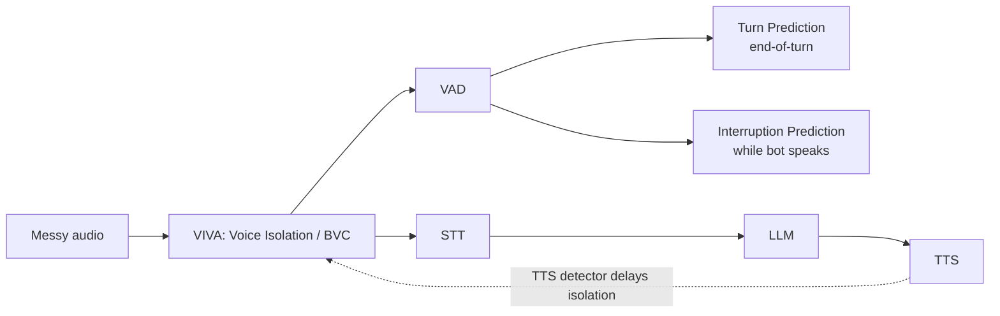

# Module 4 — Developer platform

**Status:** IN_PROGRESS (official + third-party integration docs; developers-docs.krisp.ai not yet read directly)
**Last updated:** 2026-11-13

## 1. Offerings
| Offering | Purpose | Runs where | Evidence | Confidence |
|---|---|---|---|---|
| VIVA SDK (2.0) | Voice AI agents: clean input + turn-taking | Server-side in customer's audio pipeline, before STT; CPU-only; TP v3 also on-device | E021, E022 | VERIFIED |
| RTC SDK | Human-to-human calls: noise, accent, translation | Customer device (native + Web/WASM) | E001, E031, E034 | INFERRED |
| Voice Translation SDK | Live speech-to-speech translation | Windows/macOS/Web; local NC, then cloud | E033 | VERIFIED |
| Voice Translation API | Self-serve streaming translation | Cloud, WebSocket, REST token mint | E032 | INFERRED |
| SDK distribution API | Download SDKs/models in CI | Cloud REST | E032 | INFERRED |
| Local Monitoring API | Read Krisp Desktop state | localhost WebSocket | E020 | VERIFIED |

## 2. Capability matrix
| Capability | VIVA SDK | RTC SDK | Cloud API | Evidence |
|---|---|---|---|---|
| Voice isolation (noise + other voices, one model) | ✅ v3 (+ lite variant) | ✅ (BVC) | ⚠️ unknown | E021, E025, S18 |
| Noise cancellation | via isolation | ✅ | ⚠️ unknown | E001 |
| VAD | ✅ (8–48 kHz) | ⚠️ unknown | ⚠️ unknown | E021, E028 |
| Turn prediction (end-of-turn) | ✅ v3, 12+ langs | ❌ not listed | ⚠️ unknown | E024 |
| Interruption prediction | ✅ v1, English | ❌ not listed | ⚠️ unknown | E023 |
| Signal detectors (TTS, accent, gender) | ✅ | ❌ not listed | ⚠️ unknown | E021 |
| Accent conversion | ❌ not listed | ✅ (SDK, on-device/on-prem) | ⚠️ unknown | E034 |
| Voice translation | ❌ not listed | ✅ (VT SDK) | ✅ WebSocket (INFERRED) | E032, E033 |

"Not listed" means absent from the sources consulted, not proven absent.

## 3. Documented integration contract (VIVA, via Pipecat/LiveKit docs)
- Distribution: Python wheel (`krisp_audio`) + per-feature `.kef` model files
  from the developer portal (sdk.krisp.ai). Node SDK `@krisp/viva-node-sdk`. (E026, S14)
- Licensing: API key required from SDK v1.6.1; one SDK instance shared per
  process; the first component's key wins. (E026, E027)
- Models: filter (`krisp-viva-tel-v2`, `krisp-viva-pro` ≤32 kHz), turn
  (`krisp-viva-tt-v2` / `tp-v3`), IP (`ip-v1`/`ip-v3`), VAD (`vad-v2`). (E023, E026, S13)
- Frame sizes: 10/15/20/30/32 ms (filter, IP); IP model native frame 40 ms. (E023, E027)
- Sample rates: 8, 16, 24, 32, 44.1, 48 kHz. (E028)
- Filter params: isolation level 0–100; optional TTS-detection model delays
  isolation until bot playback stops. (E027)
- Turn: streaming, frame-by-frame, accepts external VAD flag per frame. (E029)
- IP: per-frame probability 0–1, threshold default 0.4, triggered only after VAD detects speech. (E023, S13)

## 4. Documented pipeline

Order isolation → turn-taking is VERIFIED (E025); VAD placement between them
is INFERRED from the Pipecat integration (IP runs once VAD fires).

## 5. Playbook claims — verification status
| Claim | Result | Evidence |
|---|---|---|
| VIVA & RTC on customer side; API in cloud over WebSocket | **Partly verified.** VIVA runs in the customer's (server-side) pipeline; Translation API is a WebSocket (INFERRED) | E022, E032 |
| Isolation before VAD/turn/STT | **Verified** for isolation → turn-taking and → STT | E022, E025 |
| Voice isolation latency ≈ 20 ms | **Not found** | E036 |
| Interruption prediction separates backchannels | **Verified** | E023 |
| Browser SDK uses WASM | **Verified** (2023 capture); Workers/Web Audio unconfirmed | E031 |

## 6. Implications for our own build
- Krisp's public turn-taking test set (E024) can serve as a neutral benchmark
  for our endpointing model.
- Interface shape to emulate (our own design): frame-based processors
  (10–32 ms), per-frame probabilities with configurable thresholds,
  external-VAD input to turn detection, and an IP gate that only fires after VAD.
- Licensing Krisp VIVA directly is a real option. Access is sales-gated
  (E035), or bundled through LiveKit Cloud.

## 7. Outstanding
- Read developers-docs.krisp.ai directly: sdk-or-api, voice-isolation, RTC
  SDK, Browser SDK, interrupt-prediction pages.
- Latency/CPU figures, RTC SDK capability list, Cloud API message schema.
