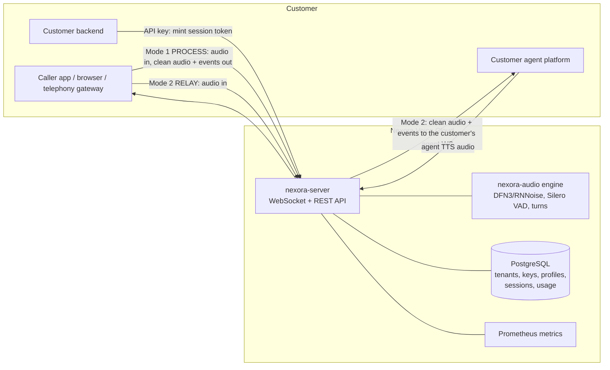
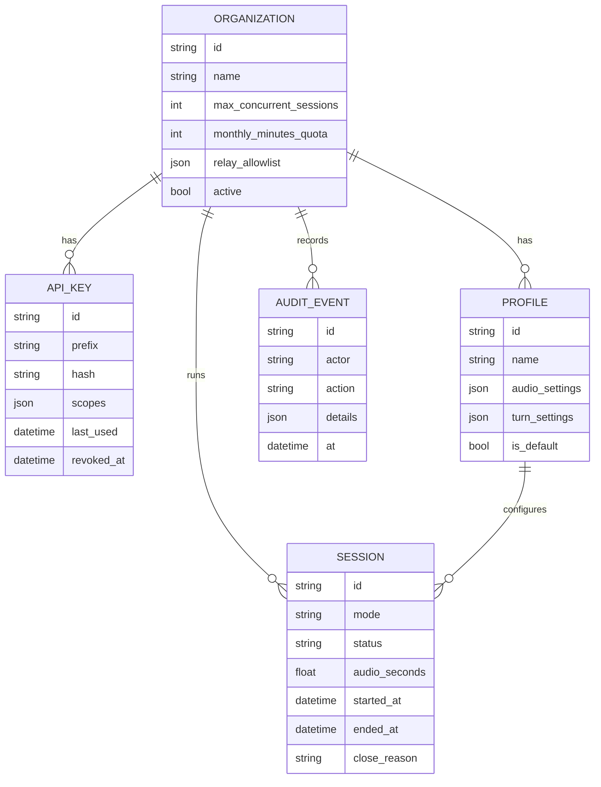

# Nexora Voice Cloud: enterprise plan

**Goal:** an enterprise voice-processing service. Customers bring their own audio streams
(WebSocket) and their own AI agent platforms. Nexora cleans the audio and tells their
agent when the user speaks, finishes, or interrupts. It can be deployed as a hosted
multi-tenant cloud service (SaaS) or self-hosted inside a customer's VPC.

## 1. How customers integrate

| Mode | Endpoint | Who connects | When to use |
|---|---|---|---|
| **Process** | `wss://…/v1/stream` | Customer's server or client | The customer keeps full control: sends audio, gets clean audio + events back on the same socket |
| **Relay** | `wss://…/v1/relay` | Customer's caller app | Nexora sits in the middle and forwards to the customer's agent WebSocket (URL on the org's allowlist) |

Authentication: server-to-server with an **API key** (`Authorization: Bearer nx_…`);
browsers and mobile apps with a short-lived **session token** that the customer's
backend mints with its API key (the key never reaches the client).

## 2. Components

| Component | Tech | Responsibility |
|---|---|---|
| Audio engine | `nexora-audio` (this repo) | Noise removal, enhancement, VAD, turn events, codecs |
| API server | FastAPI + uvicorn | WebSocket streaming, REST admin API, auth, limits |
| Worker pool | Thread pool sized to CPU cores | Runs audio processing off the event loop |
| Database | PostgreSQL (SQLite for dev/tests), SQLAlchemy 2 | Orgs, API keys (hashed), profiles, sessions, usage, audit log |
| Metrics | Prometheus client (`/metrics`) | Active sessions, audio minutes, processing latency, rejections |
| Logs | JSON structured logs | One line per lifecycle event, with org and session IDs, never audio |
| Client SDK | `nexora_client` (Python, async) | Simple integration for customers |
| Deployment | Docker image, docker-compose, Kubernetes manifests | Self-hosted or SaaS |

## 3. Data model

Usage = sum of `audio_seconds` per org per day/month (the billing unit is audio minutes processed).

## 4. Security and compliance baseline
- API keys: 256-bit random, shown once, stored as HMAC-SHA256 with a server pepper. Prefix kept for display.
- Scopes: `stream` (use the audio API), `admin` (manage keys/profiles), `usage:read`.
- Session tokens: JWT (HS256), 5-minute default lifetime, bound to org + profile + mode.
- **No audio is stored.** Only metadata (durations, event counts, timings) is persisted.
- Relay targets must match the org's allowlist. Private/loopback addresses are blocked
  unless the server runs in self-hosted mode (SSRF protection).
- Limits: per-org concurrent sessions, monthly minute quota, per-server capacity,
  max message size, idle timeout. Rejections use standard WebSocket close codes.
- Audit log of every admin action. Super-admin bootstrap key from the environment only.
- TLS terminates at the load balancer / ingress.

## 5. Phases

Order after E1: get nexora-audio into real calls (E2), fix the weakest audio cases
(E3), make voice agents feel natural (E4, E5), then production and commercial work
(E6 to E10), then the hardest research item (E11). Each phase gets its own spec,
approved before implementation.

| Phase | Scope | Done when | Status |
|---|---|---|---|
| E1 | API server: Process + Relay WebSockets, orgs/keys/profiles/sessions/usage, session tokens, limits, metrics, health, JSON logs, Python client SDK, Docker + compose, tests | §7 criteria pass | **done 2026-11-13** |
| E2a | **Quality lab:** test corpus v1 (real phone calls, babble, music, echo, turns, packet loss), metric suite, CI quality gates, baseline report. Details: `nexora-audio/docs/VOICE_QUALITY_PLAN.md` | Baseline measured on every set; gates run on every audio pull request | **done 2026-11-13**: `nexora-audio/docs/QUALITY_BASELINE.md`. Also shipped the speech guard (phone speech cut 77.9% → 3.6% worst case) |
| E2 | **Dograh integration:** a `nexora` engine in Dograh's `services/pipecat/noise_reduction/factory.py` wrapping nexora-audio as a Pipecat audio filter, selectable per agent (DeepFilterNet3, RNNoise or off), kept inside Dograh's fail-open wrapper. Plus live per-call quality metrics, packet-loss concealment and Opus | A Dograh test call runs through nexora-audio; a filter fault never drops the call; added latency matches `latency_ms`; packet-loss gate passes | **done 2026-11-13** (`nexora-audio/docs/E2_SPEC.md`): Pipecat filter + Dograh patch (`integrations/dograh/`), loss concealment (5% loss: STOI drop 0.092 → 0.039), Opus input, per-call quality numbers stored per session |
| E3 | **Phone-line quality:** test set of real 8 kHz (μ-law/A-law) speech and babble/crowd noise; baseline STOI, SI-SDR and audible-speech cut; tune or swap the model for narrowband and babble | Both cases beat today's baseline on the test set with no extra audible speech cut; results in `benchmarks.md` | **partly done 2026-11-14** (`nexora-audio/docs/E3_SPEC.md`): phone speech cut fixed in E2a (speech guard); background-talker gate (babble pauses -24 → -37 dB). Open: background as loud as the caller (E11), -5 dB SNR, narrowband fine-tune (needs real calls + GPU) |
| E4 | **Echo cancellation:** a working backend for the existing `echo_cancellation` + `reference=` interface, using the agent's TTS audio as reference; base: WebRTC AEC3 (BSD-3) | Agent's own voice in the caller's audio is suppressed enough that it no longer triggers false barge-ins in tests | **done 2026-11-14** (`nexora-audio/docs/E4_SPEC.md`): echo reference (auto in Relay mode), echo-aware barge-in, WebRTC AEC3 built and bundled. False interruptions from echo 12 → 0; echo removed 26.9 dB median |
| E5 | **Smarter end-of-turn:** a learned model that judges whether the speaker has finished, alongside the silence-based TurnTracker; Smart Turn is the first candidate (licence and model download to verify first) | Fewer cut-offs and shorter reply delay than silence-only on a labelled turn set | **partly done 2026-11-14** (`nexora-audio/docs/E5_SPEC.md`): Smart Turn v3.2 (BSD-2) bundled and on by default; cut-offs inside unfinished sentences 71% → 14%, after clauses 73% → 36%; median reply gap unchanged (648 ms), p90 longer (1.3 s). E5b: caller transcript as a second cue (`transcript` message), no cost, no extra gain over Smart Turn in the lab (`E5B_SPEC.md`). Open: real calls, Arabic |
| E6 | **Production infrastructure:** Kubernetes manifests (Deployment, HPA on active sessions, PDB), Alembic migrations, Redis-backed cluster-wide concurrency limits | Scales out and in under load without dropping sessions; limits hold across instances | **built 2026-11-14** (`docs/E6_SPEC.md`, `deploy/k8s/`): Redis session leases (limits across instances, fall back per pod if Redis is down), SIGTERM draining + client retry on 1013, Alembic migrations + Job, Kustomize manifests validated against K8s 1.30/1.33 schemas. Not yet run on a real cluster under load (E10; `OPEN_ISSUES.md` I-017 to I-021) |
| E7 | **Packaging and devices:** wheels for Linux arm64 and macOS (bundled native libraries built per platform); live microphone/speaker streaming (nexora-audio Phase 4 + 6, needs a real machine) | `pip install` works on each platform and the test suite passes there; live device demo runs | **built 2026-11-14** (`nexora-audio/docs/E7_SPEC.md`): native libraries built from pinned sources and tested on Linux ARM, Intel Mac, Apple Silicon (RNNoise fallback: libdf crashes there, I-031); platform wheels; live mic/speaker streaming tested on a simulated sound card. Open: real hardware demo (I-024), Windows |
| E8 | Admin dashboard (web): orgs, keys, profiles, usage charts | Customer admin manages keys and sees usage without the API | **built 2026-11-14** (`docs/E8_SPEC.md`): `/dashboard/`, no third-party code, strict CSP, tested end to end in headless Chrome (sign in, usage, create/revoke key, profile, sessions, audit) |
| E9 | Billing integration (Stripe metered usage), SSO (OIDC) for the dashboard, audit export | Invoice usage matches recorded audio seconds | **built 2026-11-14** (`docs/E9_SPEC.md`): hourly Stripe meter events (to the second, never twice, retried), OIDC SSO with PKCE + CSRF-protected session cookie, CSV/JSONL audit and session export; tested against simulated Stripe and identity provider (no real accounts here) |
| E10 | Load and soak tests (100s of concurrent sessions), chaos tests, security review / pen test | Agreed targets hold for 72 hours; no open high-severity findings | **partly done 2026-11-14** (`docs/E10_RESULTS.md`, `docs/SECURITY_REVIEW.md`): load tool, capacity corrected to 2 calls/core (old default collapsed), overload guard, cheap refusals, 10-min soak (0 failures), chaos tests (2 cleanup bugs fixed), security review (5 fixes, none high open). Open: 72 h / hundreds of sessions on real infrastructure, independent pen test |
| E11 | **Background voice cancellation (research spike):** remove other nearby speakers, not only noise (Krisp's signature feature); needs a speaker-aware model; survey permissively licensed models and datasets first | Go/no-go report with measured results on a multi-speaker test set | **done 2026-11-14** (`nexora-audio/docs/E11_REPORT.md`): no permissive real-time model exists; speaker-embedding gate measured on 44 mixes: **no-go** (removes 3-9 dB, cuts 11-13% of the caller, 8-16% CPU per call). **Go** only as a 6-10 week training project (personalised DeepFilterNet), if the product needs it |

## 6. Capacity planning
From `nexora-audio/docs/benchmarks.md`: about 5.6 concurrent sessions per CPU core with the
default pipeline (DeepFilterNet3), about 14.7 with RNNoise. Plan around 4 per core and 10
per core to keep headroom. Each server instance has a configured capacity
(`NEXORA_MAX_SESSIONS`, default = 4 × CPU cores). New sessions beyond it are rejected
with close code 1013 ("try again later") so a load balancer can retry another instance.

## 7. Acceptance criteria for E1
1. A customer can create an API key, open `/v1/stream`, and receive clean audio and turn events.
2. A browser-style client can connect with a minted session token, never the API key.
3. Relay mode forwards to an allowlisted agent URL and refuses others.
4. Concurrency, quota and capacity limits reject with the documented close codes.
5. Usage (audio seconds) is recorded per session and summed per org.
6. `/healthz`, `/readyz`, `/metrics` work; logs are JSON and contain no audio or keys.
7. All of the above is covered by automated tests; the Docker image definition is provided.
