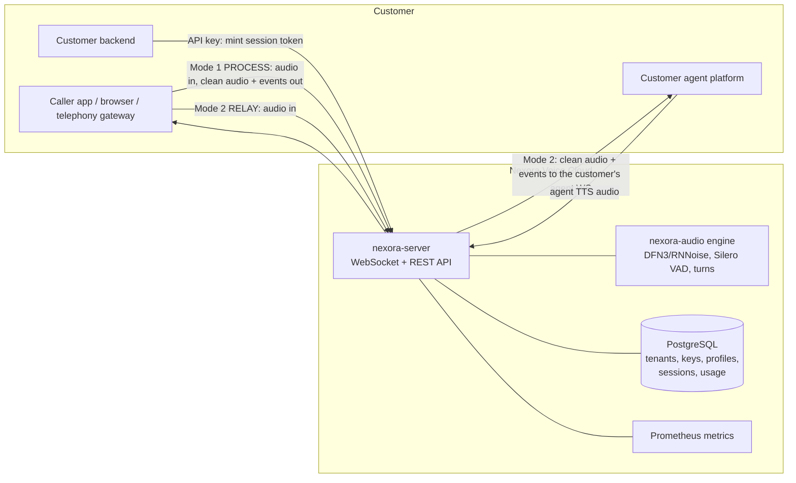
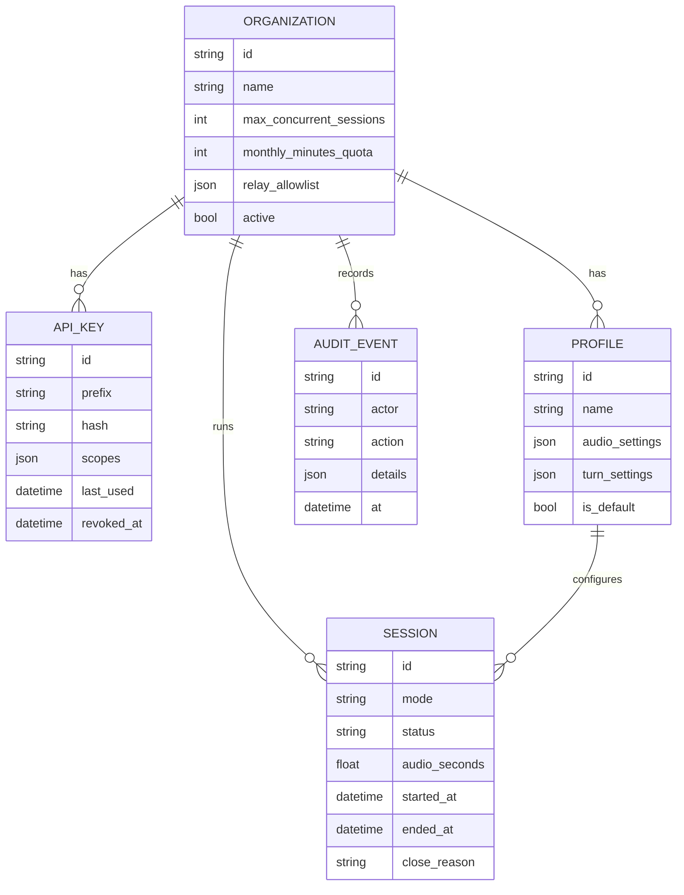

# Nexora Voice Cloud: enterprise plan

**Goal:** an enterprise voice-processing service. Customers bring their own audio streams
(WebSocket) and their own AI agent platforms. Nexora cleans the audio and tells their
agent when the user speaks, finishes, or interrupts. It can be deployed as a hosted
multi-tenant cloud service (SaaS) or self-hosted inside a customer's VPC.

## 1. How customers integrate

| Mode | Endpoint | Who connects | When to use |
|---|---|---|---|
| **Process** | `wss://…/v1/stream` | Customer's server or client | The customer keeps full control: sends audio, gets clean audio + events back on the same socket |
| **Relay** | `wss://…/v1/relay` | Customer's caller app | Nexora sits in the middle and forwards to the customer's agent WebSocket (URL on the org's allowlist) |

Authentication: server-to-server with an **API key** (`Authorization: Bearer nx_…`);
browsers and mobile apps with a short-lived **session token** that the customer's
backend mints with its API key (the key never reaches the client).

## 2. Components

| Component | Tech | Responsibility |
|---|---|---|
| Audio engine | `nexora-audio` (this repo) | Noise removal, enhancement, VAD, turn events, codecs |
| API server | FastAPI + uvicorn | WebSocket streaming, REST admin API, auth, limits |
| Worker pool | Thread pool sized to CPU cores | Runs audio processing off the event loop |
| Database | PostgreSQL (SQLite for dev/tests), SQLAlchemy 2 | Orgs, API keys (hashed), profiles, sessions, usage, audit log |
| Metrics | Prometheus client (`/metrics`) | Active sessions, audio minutes, processing latency, rejections |
| Logs | JSON structured logs | One line per lifecycle event, with org and session IDs, never audio |
| Client SDK | `nexora_client` (Python, async) | Simple integration for customers |
| Deployment | Docker image, docker-compose, Kubernetes manifests | Self-hosted or SaaS |

## 3. Data model

Usage = sum of `audio_seconds` per org per day/month (the billing unit is audio minutes processed).

## 4. Security and compliance baseline
- API keys: 256-bit random, shown once, stored as HMAC-SHA256 with a server pepper. Prefix kept for display.
- Scopes: `stream` (use the audio API), `admin` (manage keys/profiles), `usage:read`.
- Session tokens: JWT (HS256), 5-minute default lifetime, bound to org + profile + mode.
- **No audio is stored.** Only metadata (durations, event counts, timings) is persisted.
- Relay targets must match the org's allowlist. Private/loopback addresses are blocked
  unless the server runs in self-hosted mode (SSRF protection).
- Limits: per-org concurrent sessions, monthly minute quota, per-server capacity,
  max message size, idle timeout. Rejections use standard WebSocket close codes.
- Audit log of every admin action. Super-admin bootstrap key from the environment only.
- TLS terminates at the load balancer / ingress.

## 5. Phases

| Phase | Scope | Status |
|---|---|---|
| E1 | API server: Process + Relay WebSockets, orgs/keys/profiles/sessions/usage, session tokens, limits, metrics, health, JSON logs, Python client SDK, Docker + compose, tests | **done 2026-11-13** |
| E2 | Kubernetes manifests (Deployment, HPA on active sessions, PDB), Alembic migrations, Redis-backed cluster-wide concurrency limits | planned |
| E3 | Admin dashboard (web): orgs, keys, profiles, usage charts | planned |
| E4 | Billing integration (Stripe metered usage), SSO (OIDC) for the dashboard, audit export | planned |
| E5 | Load and soak tests (100s of concurrent sessions), chaos tests, security review / pen test | planned |
| E6 | Engine roadmap: learned end-of-turn model, echo cancellation with agent TTS reference, multi-platform wheels | planned |

## 6. Capacity planning
From `nexora-audio/docs/benchmarks.md`: about 5.6 concurrent sessions per CPU core with the
default pipeline (DeepFilterNet3), about 14.7 with RNNoise. Plan around 4 per core and 10
per core to keep headroom. Each server instance has a configured capacity
(`NEXORA_MAX_SESSIONS`, default = 4 × CPU cores). New sessions beyond it are rejected
with close code 1013 ("try again later") so a load balancer can retry another instance.

## 7. Acceptance criteria for E1
1. A customer can create an API key, open `/v1/stream`, and receive clean audio and turn events.
2. A browser-style client can connect with a minted session token, never the API key.
3. Relay mode forwards to an allowlisted agent URL and refuses others.
4. Concurrency, quota and capacity limits reject with the documented close codes.
5. Usage (audio seconds) is recorded per session and summed per org.
6. `/healthz`, `/readyz`, `/metrics` work; logs are JSON and contain no audio or keys.
7. All of the above is covered by automated tests; the Docker image definition is provided.
