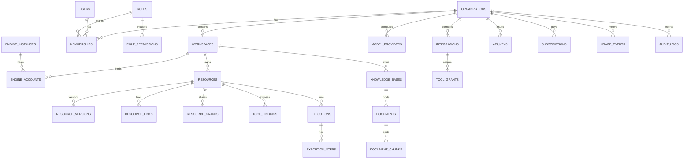

# NEXORA AI: database architecture

| | |
|---|---|
| Status | Draft for approval (document 4 of 6) |
| Scope | The `nexora_core` database owned by NEXORA. Engine databases (`dograh`, `dify`) are owned by the engines and never written by NEXORA |
| Engine | PostgreSQL 17 + `pgvector`, async SQLAlchemy 2, Alembic migrations |

## 1. Conventions

| Rule | Detail |
|---|---|
| IDs | Text, prefixed, random: `org_…`, `ws_…`, `usr_…`, `res_…`, `exe_…` (pattern already used by `nexora-server`). Usage and audit tables use `bigint` identity keys for volume |
| Tenancy columns | Every tenant-owned row has `organization_id`. Workspace-scoped rows also have `workspace_id` |
| Row-level security | RLS on all tenant tables: `organization_id = current_setting('nexora.org_id')`. The app sets it per transaction. A separate `nexora_admin` role bypasses RLS for platform jobs |
| Timestamps | `created_at`, `updated_at` as `timestamptz` (UTC). Soft delete with `deleted_at` on user-facing resources |
| Secrets | Never in plain columns. Rows hold `secret_id` → `secrets` (envelope-encrypted) |
| Enums | PostgreSQL `text` + `CHECK` constraints (easier migrations than native enums) |
| JSON | `jsonb` only for engine-specific config and flexible metadata, never for anything filtered or joined often |
| Partitioning | `usage_events`, `audit_logs` and `execution_steps` partitioned by month |

## 2. Entity overview

## 3. Tables

### 3.1 Identity and tenancy

**organizations**
| Column | Type | Notes |
|---|---|---|
| id | text PK | `org_…` |
| name, slug | text | `slug` unique |
| status | text | `active`, `suspended`, `deleted` |
| deployment_mode | text | `shared`, `dedicated`, `on_prem` (drives AI engine choice) |
| data_region | text | e.g. `me-central`, `eu-west` |
| settings | jsonb | Branding, retention defaults, telemetry flags |
| created_at, updated_at, deleted_at | timestamptz | |

**workspaces**
| Column | Type | Notes |
|---|---|---|
| id | text PK | `ws_…` |
| organization_id | text FK | |
| name, slug | text | unique `(organization_id, slug)` |
| environment | text | `development`, `staging`, `production` |
| status | text | `provisioning`, `active`, `failed`, `archived` |
| created_at, updated_at, deleted_at | timestamptz | |

**users** — `id`, `email` (citext, unique), `name`, `avatar_url`, `password_hash`
(nullable, argon2id), `email_verified_at`, `mfa_secret_id` (FK secrets, nullable),
`is_platform_owner` (bool), `status`, `last_login_at`, timestamps.

**user_identities** — external logins: `id`, `user_id`, `provider` (`google`,
`microsoft`, `oidc:<id>`, `saml:<id>`), `subject`, unique `(provider, subject)`.

**user_sessions** — `id` (random, stored hashed), `user_id`, `created_at`,
`expires_at`, `revoked_at`, `ip`, `user_agent`, `active_organization_id`.

**memberships**
| Column | Type | Notes |
|---|---|---|
| id | text PK | |
| organization_id | text FK | |
| user_id | text FK | |
| workspace_id | text FK, nullable | NULL = organization-level membership |
| role_id | text FK | |
| unique | | `(user_id, organization_id, workspace_id)` with `NULLS NOT DISTINCT` |

**invitations** — `id`, `organization_id`, `workspace_id` (nullable), `email`,
`role_id`, `token_hash`, `expires_at`, `accepted_at`, `invited_by`.

### 3.2 Authorization

**roles** — `id`, `organization_id` (NULL = system role), `key`, `name`, `scope`
(`platform`, `organization`, `workspace`), `is_system`.
System roles seeded: `platform_owner`, `org_owner`, `org_admin`, `workspace_admin`,
`developer`, `operator`, `viewer`.

**permissions** — static catalogue, seeded from code: `key` PK such as
`voice_agent:create`, `workflow:run`, `knowledge:write`, `member:invite`, `billing:read`,
`api_key:manage`, `integration:manage`, `audit:read`.

**role_permissions** — `(role_id, permission_key)` PK.

**resource_grants** — sharing a single resource beyond its workspace:
`id`, `organization_id`, `resource_id`, `principal_type` (`user`, `role`,
`workspace`), `principal_id`, `permission_key`, `granted_by`, `created_at`.

Check order: platform owner → organization role → workspace role → resource grant.
Deny by default.

### 3.3 Engines

**engine_instances** — one row per running engine deployment.
| Column | Type | Notes |
|---|---|---|
| id | text PK | `eng_…` |
| kind | text | `voice` or `ai` (later `audio`) |
| implementation | text | `dograh`, `dify_app`, `graphon` |
| version | text | Pinned version / image tag |
| base_url | text | Private network URL |
| tenancy | text | `shared` or `dedicated` |
| dedicated_organization_id | text FK, nullable | Required when `implementation = 'dify_app'` (licence rule, enforced with a CHECK constraint) |
| admin_secret_id | text FK, nullable | Engine admin credential if any |
| capabilities | jsonb | Capability flags (Architecture §5.3) |
| health_status, health_checked_at | text, timestamptz | |

**engine_accounts** — the tenant inside an engine that a workspace maps to.
| Column | Type | Notes |
|---|---|---|
| id | text PK | |
| organization_id, workspace_id | text FK | |
| engine_instance_id | text FK | |
| kind | text | `voice` / `ai`; unique `(workspace_id, kind)` |
| external_tenant_id | text | Dograh organization id, Dify workspace (tenant) id, or graphon namespace |
| credential_secret_id | text FK | Dograh org `X-API-Key`, etc. |
| status | text | `provisioning`, `active`, `error` |

**engine_sync_state** — reconciliation cursors per engine account: `engine_account_id`,
`object_type`, `cursor`, `last_synced_at`, `last_error`.

### 3.4 Resource registry

**resources**
| Column | Type | Notes |
|---|---|---|
| id | text PK | `res_…` (public, stable ID used by the NEXORA API) |
| organization_id, workspace_id | text FK | |
| resource_type | text | `voice_agent`, `ai_agent`, `ai_workflow`, `chat_app`, `knowledge_base`, `campaign`, `phone_number` |
| engine_kind | text | `voice`, `ai`, `nexora` (for NEXORA-native objects) |
| engine_account_id | text FK, nullable | |
| engine_resource_id | text, nullable | Dograh workflow id/uuid, Dify app id, graphon workflow id |
| engine_secret_id | text FK, nullable | Per-resource engine key (Dify app API key) |
| name, description | text | |
| status | text | `draft`, `active`, `paused`, `error`, `deleted` |
| current_version_id | text FK, nullable | |
| tags | text[] | |
| created_by | text FK users | |
| created_at, updated_at, deleted_at | timestamptz | |
| unique | | `(engine_account_id, engine_resource_id)` |
| indexes | | `(workspace_id, resource_type, status)`, GIN on `tags` |

**resource_versions** — `id`, `resource_id`, `version` (int), `engine_version_ref`
(Dograh workflow version / Dify app version), `definition` (jsonb snapshot, for diff and
rollback), `published_at`, `published_by`.

**resource_links** — typed edges between resources: `id`, `organization_id`,
`from_resource_id`, `to_resource_id`, `link_type` (`uses_workflow`, `uses_knowledge`,
`uses_tool`, `hands_off_to`), `config` (jsonb). Feeds the dependency graph shown in the
portal and the delete-protection check.

### 3.5 Orchestration

**tool_bindings** — how a voice agent (or AI agent) is allowed to call a NEXORA target.
| Column | Type | Notes |
|---|---|---|
| id | text PK | `tb_…`, appears in the internal tool URL |
| organization_id, workspace_id | text FK | |
| caller_resource_id | text FK | e.g. the voice agent |
| target_resource_id | text FK | e.g. the AI workflow or knowledge base |
| mode | text | `sync`, `async`, `sync_then_async` |
| deadline_ms | int | Default 3500 |
| input_mapping, output_mapping | jsonb | Field mapping and the `say` template |
| signing_secret_id | text FK | HMAC for inbound calls |
| requires_approval | bool | |
| enabled | bool | |

**executions** (partitioned by `created_at` month)
| Column | Type | Notes |
|---|---|---|
| id | text PK | `exe_…` |
| organization_id, workspace_id | text | |
| resource_id | text | What ran |
| trigger | text | `api`, `portal`, `tool_call`, `schedule`, `webhook` |
| parent_execution_id | text, nullable | For cross-engine chains |
| tool_binding_id | text, nullable | |
| engine_run_id | text, nullable | Dograh run id, Dify `workflow_run_id`/`task_id`, graphon run id |
| status | text | `queued`, `running`, `waiting_approval`, `succeeded`, `failed`, `cancelled`, `timed_out` |
| idempotency_key | text, nullable | unique `(organization_id, idempotency_key)` |
| input_ref, output_ref | jsonb | Small payloads inline; large ones as S3 object keys |
| error | jsonb | Normalized error (Integration spec §5) |
| trace_id | text | W3C trace id |
| started_at, finished_at, duration_ms | | |

**execution_steps** (partitioned) — `id`, `execution_id`, `seq`, `kind`
(`engine_call`, `tool`, `approval`, `retry`), `engine`, `status`, `started_at`,
`duration_ms`, `detail` (jsonb).

**approval_requests** — `id`, `organization_id`, `execution_id`, `tool_key`,
`summary`, `payload_ref`, `status` (`pending`, `approved`, `rejected`, `expired`),
`decided_by`, `decided_at`, `expires_at`.

**outbox** — transactional outbox for engine writes and event publishing: `id`
(bigint), `aggregate_type`, `aggregate_id`, `event_type`, `payload`, `created_at`,
`processed_at`, `attempts`, `last_error`.

### 3.6 Knowledge
**knowledge_bases** — `id`, `organization_id`, `workspace_id`, `resource_id` (registry),
`backend` (`nexora_pgvector`, `dify_dataset`), `external_dataset_id` (Dify), `embedding_model_config_id`,
`chunking` (jsonb), `retrieval` (jsonb: top_k, score threshold, rerank), `visibility`.

**documents** — `id`, `knowledge_base_id`, `organization_id`, `source_type` (`upload`,
`url`, `api`, `connector`), `source_uri`, `object_key` (S3), `mime_type`, `checksum`,
`status` (`queued`, `indexing`, `ready`, `error`), `version`, `metadata` (jsonb),
`indexed_at`.

**document_chunks** (NEXORA back end only) — `id` bigint, `document_id`,
`organization_id`, `knowledge_base_id`, `ordinal`, `content`, `embedding vector(N)`,
`token_count`, `metadata` jsonb. HNSW index on `embedding` per embedding dimension. Each
knowledge base is fixed to one embedding model, and changing it means reindexing.

**ingestion_jobs** — `id`, `knowledge_base_id`, `document_id`, `status`, `attempts`,
`error`, `started_at`, `finished_at`.

### 3.7 Models, integrations, developer access
**secrets** — `id`, `organization_id` (nullable for platform), `kind`, `ciphertext`
(bytea), `wrapped_dek` (bytea), `kek_id`, `created_at`, `rotated_at`. Plaintext is
never returned by any API, only `last4`/fingerprint.

**model_providers** — `id`, `organization_id`, `workspace_id` (nullable = org-wide),
`provider` (`openai`, `anthropic`, `google`, `azure_openai`, `bedrock`, `groq`,
`openrouter`, `ollama`, `openai_compatible`, `deepgram`, `elevenlabs`, `cartesia`, …),
`credential_secret_id`, `base_url`, `status`, `last_verified_at`.

**model_configs** — named presets: `id`, `organization_id`, `workspace_id`,
`model_provider_id`, `capability` (`llm`, `embedding`, `rerank`, `stt`, `tts`,
`multimodal`), `model`, `params` (jsonb), `is_default`. Pushed to engines as Dograh
provider connections or model configurations, or Dify plugin credentials.

**integrations** — `id`, `organization_id`, `type` (`mcp_server`, `http_api`,
`graphql`, `database`, `saas_connector`), `name`, `config` (jsonb, no secrets),
`credential_secret_id`, `status`.

**mcp_servers** — `integration_id` PK/FK, `transport` (`streamable_http`, `sse`,
`stdio_sandboxed`), `url`, `discovered_tools` (jsonb), `discovered_at`.

**tool_grants** — `id`, `organization_id`, `integration_id`, `tool_name` (or `*`),
`grantee_resource_id` (agent), `scopes` (text[]), `requires_approval`, `rate_limit`
(jsonb). No row = no access.

**api_keys** — `id`, `organization_id`, `workspace_id` (nullable), `name`, `prefix`
(unique), `key_hash` (HMAC-SHA256 with pepper), `scopes` (text[]), `created_by`,
`last_used_at`, `expires_at`, `revoked_at`.

**oauth_clients** — `id`, `organization_id`, `client_id`, `secret_hash`, `scopes`,
`redirect_uris`, `revoked_at`.

**idempotency_keys** — `organization_id`, `key`, `request_hash`, `response_status`,
`response_body_ref`, `created_at`, `expires_at` (24 h). PK `(organization_id, key)`.

**webhook_endpoints** — customer-facing outgoing webhooks: `id`, `organization_id`,
`workspace_id`, `url`, `events` (text[]), `signing_secret_id`, `enabled`.
**webhook_deliveries** — `id` bigint, `endpoint_id`, `event_id`, `status`, `attempts`,
`next_attempt_at`, `response_code`, `created_at`.

**engine_inbound_events** — raw, deduplicated engine webhooks: `id` bigint,
`engine_account_id`, `external_event_id`, `event_type`, `payload`, `received_at`,
`processed_at`. Unique `(engine_account_id, external_event_id)`.

### 3.8 Usage and billing
**usage_events** (partitioned monthly) — `id` bigint, `organization_id`,
`workspace_id`, `resource_id`, `execution_id`, `engine`, `provider`, `meter`
(`llm_input_tokens`, `llm_output_tokens`, `voice_minutes`, `stt_seconds`,
`tts_characters`, `workflow_executions`, `api_requests`, `storage_gb_hours`,
`ingestion_pages`), `quantity` numeric, `occurred_at`, `source_ref` (unique with `meter`,
for dedup).

**usage_daily** — `(organization_id, workspace_id, meter, day)` PK, `quantity`.

**plans** — `id`, `key` (`developer`, `startup`, `business`, `enterprise`,
`on_prem`), `limits` (jsonb per meter), `prices` (jsonb), `active`.

**subscriptions** — `id`, `organization_id`, `plan_id`, `status`, `period_start`,
`period_end`, `external_customer_id` (Stripe), `external_subscription_id`.

### 3.9 Audit
**audit_logs** (partitioned monthly, append-only, `UPDATE`/`DELETE` revoked from the app
role) — `id` bigint, `organization_id`, `workspace_id`, `actor_type` (`user`,
`api_key`, `system`), `actor_id`, `action` (`resource.created`, `member.role_changed`, …),
`target_type`, `target_id`, `ip`, `user_agent`, `details` jsonb, `occurred_at`,
`prev_hash`, `hash` (hash chain for tamper evidence).

## 4. Retention defaults
| Data | Default | Configurable per org |
|---|---|---|
| Executions + steps | 90 days | Yes |
| Usage events | 13 months raw; `usage_daily` kept | No (billing) |
| Audit logs | 1 year (enterprise: 7 years) | Yes |
| Engine inbound events | 30 days | No |
| Documents / chunks | Until deleted | Yes, per knowledge base |
| Call recordings / transcripts | Stay in Dograh's storage, governed by an org retention job calling Dograh | Yes |

## 5. Migration and seeding
- Alembic, one linear history. Every migration must be reversible or marked irreversible
  with a reason.
- Seed: permissions catalogue, system roles + role_permissions, plans.
- First boot: create the platform owner from environment variables (same pattern as
  `NEXORA_ADMIN_API_KEY` in `nexora-server`).

## 6. Acceptance criteria
1. A user in org A cannot read any row of org B even with a hand-crafted query through
   the app role (RLS test).
2. Creating a `dify_app` engine instance without `dedicated_organization_id` fails at the
   database level.
3. Deleting a resource referenced by `resource_links` or an enabled `tool_binding` is
   rejected with a list of dependents.
4. A duplicate engine webhook (`external_event_id`) is stored once.
5. A repeated API call with the same idempotency key returns the stored response.
6. Audit log rows cannot be updated or deleted by the application role, and the hash
   chain verifies.
