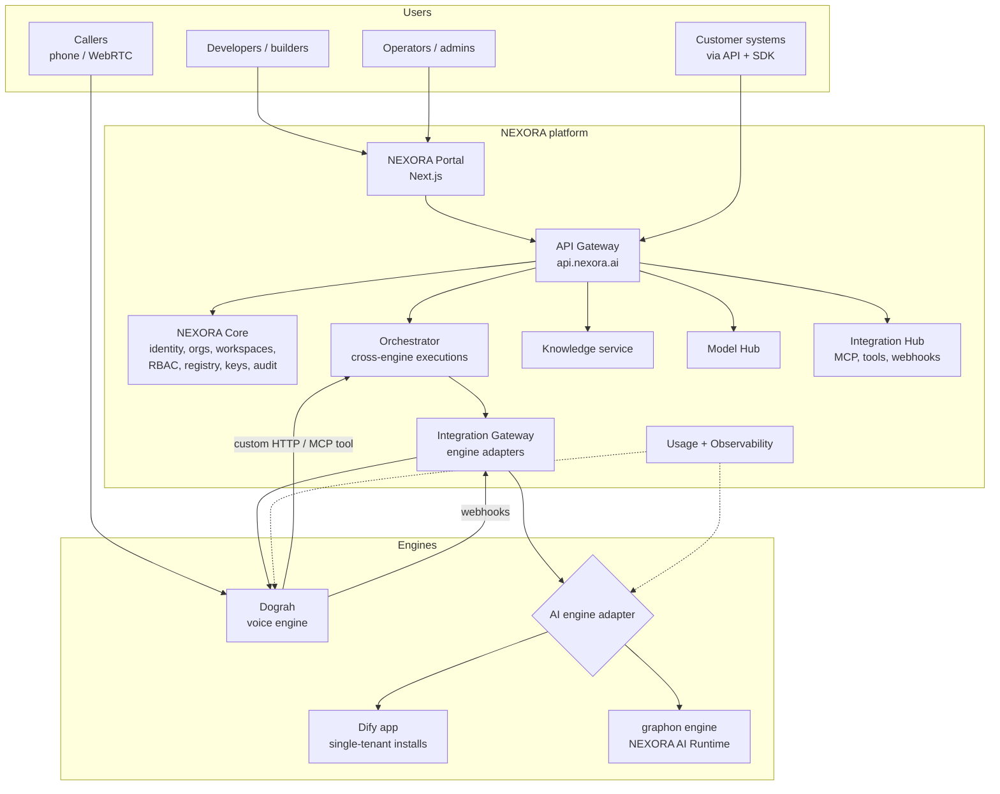
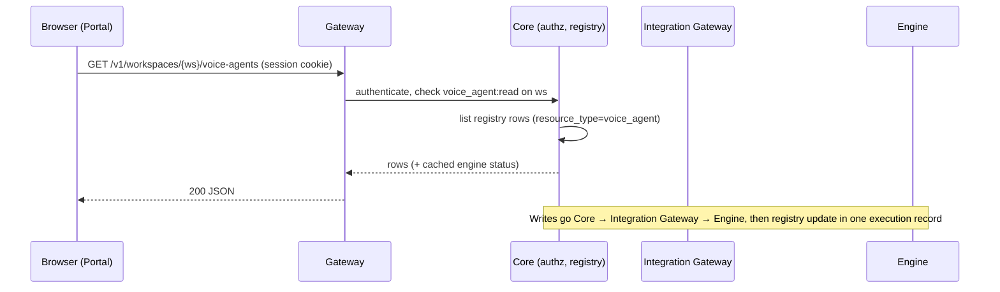
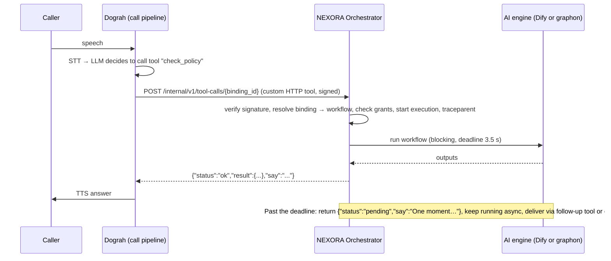

# NEXORA AI: system architecture

| | |
|---|---|
| Status | Draft for approval (document 3 of 6 in `NEXORA_PRODUCT_PLAN.md`) |
| Inputs | `NEXORA_PRODUCT_PLAN.md`, `DOGRAH_DEEP_TECHNICAL_AUDIT.md` (Dograh @ `d672de2`), `DIFY_DEEP_TECHNICAL_AUDIT.md` (Dify 1.19.0 @ `3d36480`, graphon 0.8.0) |
| Decisions taken | (1) NEXORA owns the whole user experience. (2) The AI engine sits behind an adapter with two implementations: **Dify application** (single-tenant deployments) and **graphon** (shared multi-tenant SaaS). (3) Dograh is the voice engine. |
| Companion docs | `NEXORA_DATABASE_ARCHITECTURE.md`, `NEXORA_INTEGRATION_SPECIFICATION.md`, `NEXORA_IMPLEMENTATION_ROADMAP.md` |

Endpoints named under `/v1/...` on `api.nexora.ai` are **proposed NEXORA endpoints**.
Endpoints of Dograh and Dify are only those recorded in the audits.

---

## 1. Principles

1. **NEXORA owns the product, engines execute.** Users, organizations, workspaces,
   permissions, billing, the UI and the public API are NEXORA's. Dograh and the AI
   engine are internal services nobody outside NEXORA calls directly.
2. **No shared engine databases.** NEXORA keeps references (`engine_resource_id`) to
   engine objects and never writes to engine tables.
3. **Licence-safe by construction.** No code path in shared SaaS depends on the Dify
   application. The Dify app is only ever deployed **one customer per installation**
   until LangGenius grants written authorization for multi-tenant use.
4. **Real time is protected.** A voice call never waits on anything without a
   deadline. Long AI work becomes an asynchronous job.
5. **Upgradeable engines.** Engines are pinned versions run from their own images.
   NEXORA changes them only through configuration, plugins and published extension
   points (Dograh noise-reduction factory, tools, MCP).

## 2. Context



## 3. Services NEXORA builds

All NEXORA services are Python 3.13 + FastAPI (same runtime as both engines), async
SQLAlchemy 2 + asyncpg, Alembic, Redis, ARQ for jobs. They start as **one deployable
(`nexora-core`) with separate internal modules** and split into separate services only
when scaling or ownership demands it. Module boundaries are enforced by package imports
and by each module owning its own tables.

| Module | Responsibility | Owns (tables, see DB doc) |
|---|---|---|
| `identity` | Login (email/password, OIDC, later SAML), sessions, MFA, user profiles | `users`, `user_identities`, `user_sessions` |
| `tenancy` | Organizations, workspaces, memberships, invitations | `organizations`, `workspaces`, `memberships`, `invitations` |
| `authz` | Roles, permissions, resource grants, policy checks | `roles`, `role_permissions`, `resource_grants` |
| `registry` | Unified resource registry across engines | `resources`, `resource_versions`, `resource_links` |
| `engines` | Engine instances, per-workspace engine accounts, adapters, reconciliation | `engine_instances`, `engine_accounts`, `engine_sync_state` |
| `orchestrator` | Cross-engine executions, tool bindings, sync/async runs, cancellation | `executions`, `execution_steps`, `tool_bindings` |
| `knowledge` | NEXORA Knowledge API: bases, documents, ingestion, retrieval | `knowledge_bases`, `documents`, `document_chunks` (graphon path), `ingestion_jobs` |
| `models` | Provider credentials and model configs, pushed to engines | `model_providers`, `model_configs` |
| `integrations` | MCP servers, HTTP tools, outgoing webhooks, tool scopes, approvals | `integrations`, `mcp_servers`, `tool_grants`, `approval_requests`, `webhook_endpoints`, `webhook_deliveries` |
| `developer` | API keys, OAuth clients, idempotency, rate limits | `api_keys`, `oauth_clients`, `idempotency_keys` |
| `usage` | Usage events, aggregates, quotas, plans, subscriptions | `usage_events`, `usage_daily`, `plans`, `subscriptions` |
| `audit` | Append-only audit log | `audit_logs` |
| `secrets` | Encrypted secret storage (envelope encryption, KMS/Vault-backed) | `secrets` |

### 3.1 NEXORA AI Runtime (graphon path)
A separate deployable, `nexora-ai-runtime`, because workflow execution has a different
scaling profile from the control plane.

| Part | Built on | Notes |
|---|---|---|
| Workflow execution | `graphon` 0.8.0 `GraphEngine` (Apache-2.0) | Pin the version, the API is 0.x |
| Workflow import | `graphon.dsl.loads` | Imports Dify DSL, so workflows built in a customer's Dify install can move to SaaS |
| Model + tool plugins | `dify-plugin-daemon` (Apache-2.0) | Each plugin's own licence is audited before it is bundled |
| Knowledge retrieval node | NEXORA node calling the `knowledge` module | Replaces Dify's `knowledge_retrieval` node (Dify-licensed) |
| Agent node | NEXORA-built tool-calling loop | Replaces Dify `agent`/`agent_v2` and `dify-agent` (Dify-licensed) |
| Code node | Sandboxed runner (separate container, no network by default) | `dify-sandbox` licence not verified yet, so not assumed |
| Outbound HTTP | Egress proxy with SSRF rules | Same pattern as Dify's `ssrf_proxy` and Dograh's `url_security.py` |

## 4. Engines and tenancy mapping

### 4.1 Voice engine: Dograh
- Run in `DEPLOYMENT_MODE=oss` (no dependency on Dograh's hosted MPS), `ENABLE_TELEMETRY=false`.
- **One Dograh organization per NEXORA workspace.** Dograh has organizations and
  org API keys but no roles or workspaces, so this gives hard isolation with no Dograh
  code change. NEXORA creates the Dograh org at workspace creation and stores its
  `X-API-Key` in `secrets`.
- Dograh's UI is not exposed to customers in the target product. During migration its
  voice-workflow builder may be embedded (BSD-2 allows rebranding; keep the copyright
  notice on the About page).
- nexora-audio is added as a noise-reduction engine in
  `services/pipecat/noise_reduction/factory.py` (Dograh audit §6). This is the only
  planned Dograh code change, kept in the `Sufi1512/dograh` fork and offered upstream.

### 4.2 AI engine: one adapter, two implementations

| Deployment | AI engine | Why |
|---|---|---|
| **NEXORA Cloud (shared SaaS)** | `graphon` runtime (`nexora-ai-runtime`) | Multi-tenant use of the Dify app needs written authorization |
| **Dedicated / private cloud / on-prem** | Dify app, one installation per customer, **one Dify workspace per installation** | Dify licence allows single-tenant commercial use. One workspace per install avoids the open question whether several workspaces count as multi-tenant |
| **NEXORA Cloud after a LangGenius agreement** | Either, chosen per workspace | The adapter makes it a configuration switch |

Each workspace has exactly one AI engine binding (`engine_accounts`). The portal shows
the same screens for both, and capabilities a given engine lacks are hidden by the
capability flags in §5.3.

**Dify UI rule:** Dify's `web/` console must keep the Dify logo and may not be
re-skinned, and its interaction design is protected. NEXORA therefore never embeds or
restyles it. NEXORA builds its own builder UI on React Flow. On dedicated installs a
customer may be given the Dify console as-is, unbranded by NEXORA, as an advanced tool.

### 4.3 Audio cloud (existing)
`nexora-server` (Nexora Voice Cloud) remains a separate product for customers who bring
their own agents. The portal can manage it later as a third engine type (`audio`). It is
out of scope for the first portal release.

## 5. Key runtime flows

### 5.1 Portal request


Reads come from the registry (fast, filterable, engine-independent). Engine detail is
fetched on demand. Writes follow **engine-first, registry-second** with an outbox and a
reconciliation job (Integration spec §6) so a failed step never leaves an orphan.

### 5.2 Voice agent calls an AI workflow (cross-engine)


Budgets: Dograh's custom HTTP tool default timeout is 5,000 ms (Dograh audit §3.6).
NEXORA sets its own internal deadline lower (default 3,500 ms) so it always answers
before Dograh gives up.

### 5.3 Capability flags
Every adapter publishes capabilities, for example `workflow.run.blocking`,
`workflow.run.streaming`, `chat`, `knowledge.native`, `knowledge.external`,
`mcp.expose`, `dsl.import`, `builder.native`. The portal and the public API hide or
reject actions an engine cannot do, with a clear error, not an engine stack trace.

## 6. Knowledge strategy
One NEXORA Knowledge API, two storage back ends:

| AI engine | Storage | How both engines read it |
|---|---|---|
| graphon (SaaS) | NEXORA-owned PostgreSQL + pgvector (`document_chunks`) | AI runtime: NEXORA retrieval node. Dograh: NEXORA retrieval exposed as an MCP tool or custom HTTP tool |
| Dify app (dedicated) | Dify datasets via `/v1/datasets/*` | NEXORA Knowledge API proxies to Dify. Dograh reaches it through the same NEXORA tool |

Dograh's own pgvector knowledge base stays available for voice-only agents but is not
the shared store. The "one knowledge base, many agents" promise is delivered through
the NEXORA tool, not by sharing engine databases.

## 7. Identity, access and security

- **Identity:** NEXORA-owned users. Email/password and OIDC (Google, Microsoft) in the
  first release. SAML + SCIM in the enterprise phase.
- **Sessions:** browser uses an HttpOnly, Secure, SameSite=Lax session cookie bound to a
  server-side session row (revocable). The API uses API keys (`nx_live_…`, hashed with a
  server pepper, shown once) or OAuth2 client credentials.
- **Authorization:** RBAC with the seven roles from the plan, scoped at organization or
  workspace, plus per-resource grants. Every query is filtered by `organization_id`, and
  PostgreSQL row-level security is enabled as a second line of defence.
- **Engine credentials:** never leave the server. Dograh org keys and Dify app/dataset
  keys live in `secrets`, envelope-encrypted, fetched per call.
- **Engine network:** engines sit on a private network. Only the gateway is public, plus
  Dograh's telephony webhook and media endpoints, which providers must reach. Those are
  exposed through the edge with provider signature checks where providers support them
  (Dograh audit S1).
- **Inbound tool calls from Dograh** are signed with a per-binding HMAC secret placed in
  the custom tool's header template.
- **Sensitive tools** (payments, writes to external systems) can require approval. The
  orchestrator parks the execution in `approval_requests` until a permitted user approves.
- **Audit:** every admin and data-changing action writes `audit_logs` (append-only).

## 8. Observability
- OpenTelemetry SDK in every NEXORA service. W3C `traceparent` is generated at the
  gateway or orchestrator and passed to engines in headers (Dify) or tool payloads
  (Dograh, whose spans go to Langfuse). The orchestrator records engine run IDs on the
  execution so traces can be stitched together.
- Metrics: Prometheus (the existing `nexora-server` pattern). Logs: JSON with
  `organization_id`, `workspace_id`, `execution_id` and `trace_id`, and never call audio,
  prompts or secrets at info level.
- Health: the gateway aggregates `/readyz` of Core, AI runtime, each engine instance,
  PostgreSQL and Redis, which feeds the dashboard's System Health panel.

## 9. Usage metering
Usage is recorded as `usage_events` with organization, workspace, resource, engine,
provider, meter and quantity. Sources:

| Meter | Source |
|---|---|
| Voice minutes, STT/TTS seconds | Dograh run completion webhook + run detail fetch |
| LLM tokens | AI engine run results (Dify `usage` in responses, graphon events), Dograh run metrics |
| Workflow executions | Orchestrator |
| API requests | Gateway |
| Storage, ingestion pages | Knowledge service |

Hourly roll-up into `usage_daily`. Quotas are checked at execution start (soft) and by a
periodic enforcer (hard).

## 10. Frontend (NEXORA Portal)
| Concern | Choice |
|---|---|
| Framework | Next.js 15 App Router, React 19, TypeScript (same as Dograh's UI, so Dograh components can be studied and ported where BSD allows) |
| UI | Tailwind CSS + shadcn/ui, NEXORA design tokens, dark-first theme |
| Data | TanStack Query against the NEXORA API. A typed client is generated from NEXORA's OpenAPI spec |
| Client state | Zustand (builder canvases only) |
| Builders | React Flow: Voice Flow Builder (Dograh node specs) and AI Workflow Builder (graphon node schema). Separate editors with a shared look |
| Auth | Server-side session cookie. The portal never holds engine credentials |
| Apps | `apps/web` (portal), `apps/docs` (developer portal + API reference) |

Navigation follows plan §11 (Dashboard, AI Studio, Knowledge, Integrations,
Observability, Developer, Administration).

## 11. Deployment

| Mode | Shape |
|---|---|
| Local dev | Docker Compose: `nexora-core`, `nexora-ai-runtime`, `portal`, PostgreSQL 17 + pgvector, Redis, MinIO, Dograh (`api`, `ui` optional, `coturn`), plugin daemon. Dify optional profile |
| NEXORA Cloud | Kubernetes. Shared control plane + AI runtime. Dograh as a shared pool (one Dograh org per workspace). Managed PostgreSQL, Redis, S3 |
| Dedicated / private cloud | One namespace or VPC per customer: same images plus a Dify installation (single workspace) |
| On-prem | Helm chart (reuses Dograh's `deploy/helm/dograh` as the base for the voice part). Telemetry off by default |

Separate PostgreSQL databases per owner: `nexora_core`, `dograh`, `dify` (dedicated only).

## 12. Repository layout
A new monorepo `nexora-platform` for NEXORA-owned code (layout from plan §9).
`Voice-Analysis` stays the research and audio repo. Engines are referenced by pinned
image tags built from the forks `Sufi1512/dograh` and `Sufi1512/dify`, not vendored.

```
nexora-platform/
  apps/web            Portal
  apps/docs           Developer portal
  services/core       nexora-core (modules in §3)
  services/ai-runtime graphon-based AI runtime
  packages/ui         Design system
  packages/api-client Generated TS client
  sdks/python, sdks/typescript
  engines/            Pinned versions, compose/helm overlays, nexora-audio Dograh patch
  infrastructure/     docker, k8s/helm, monitoring
  docs/               These architecture docs move here
```

## 13. Open decisions
| # | Decision | Default until decided |
|---|---|---|
| D1 | Ask LangGenius for multi-tenant authorization (and on what terms) | graphon for SaaS, Dify only for dedicated installs |
| D2 | Verify `dify-sandbox` licence | Use NEXORA's own sandboxed code runner |
| D3 | Shared Dograh pool versus Dograh per tier for large customers | Shared pool, dedicated pool for enterprise plans |
| D4 | Secrets back end (Vault versus cloud KMS) | Envelope encryption with a KMS-style interface. Local key in dev |
| D5 | Monorepo name and location | `Sufi1512/nexora-platform` |
